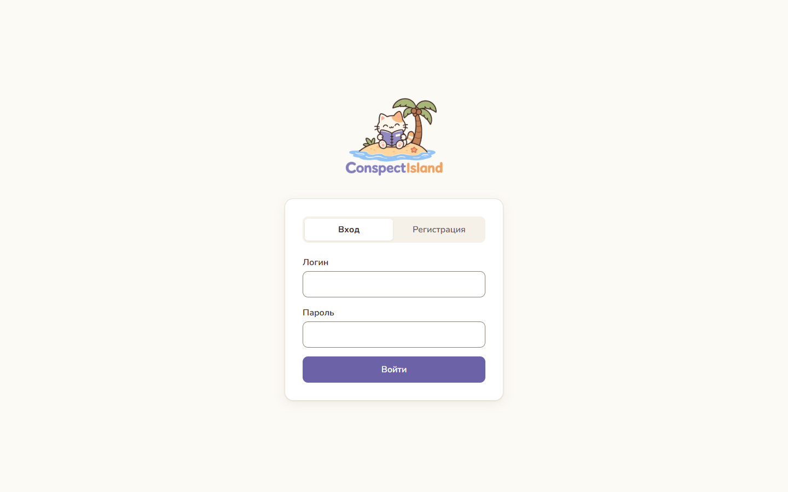
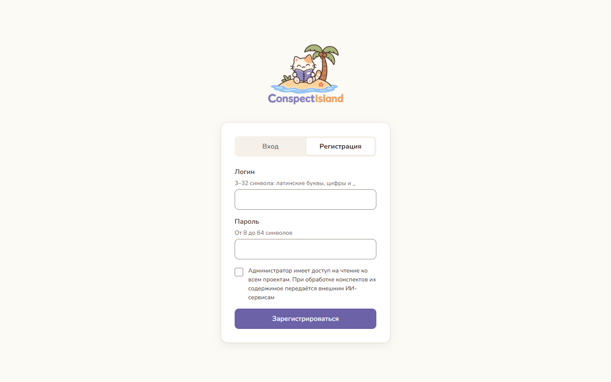
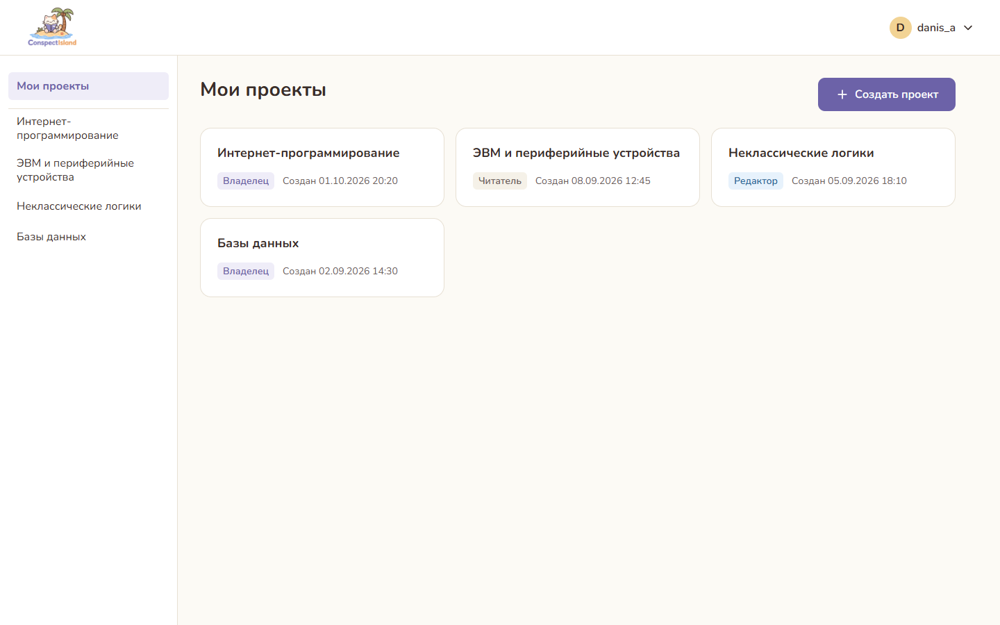
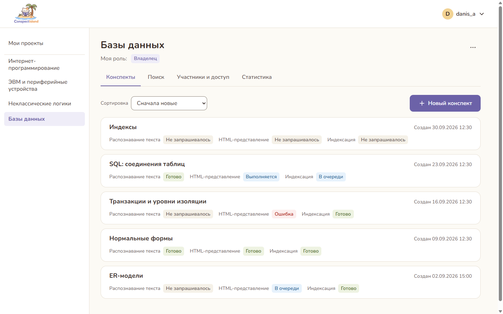
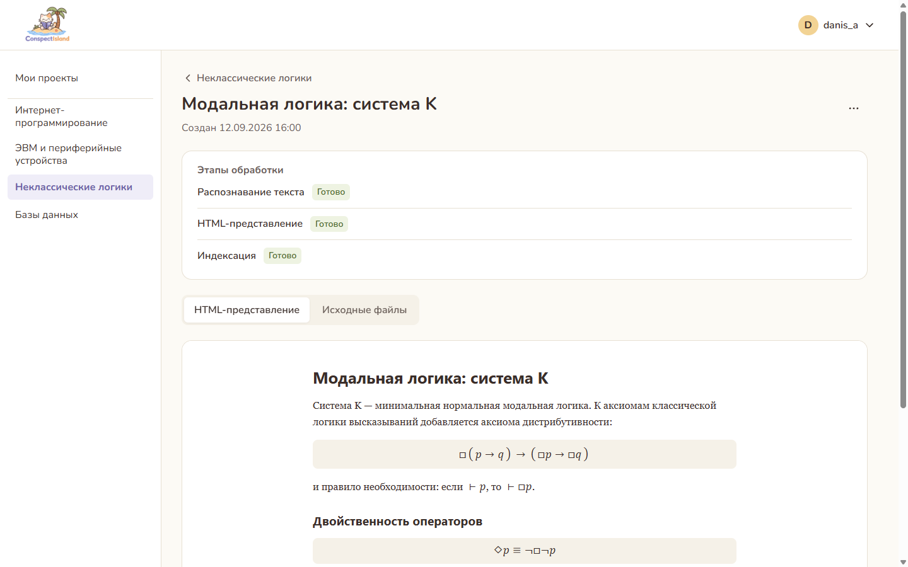
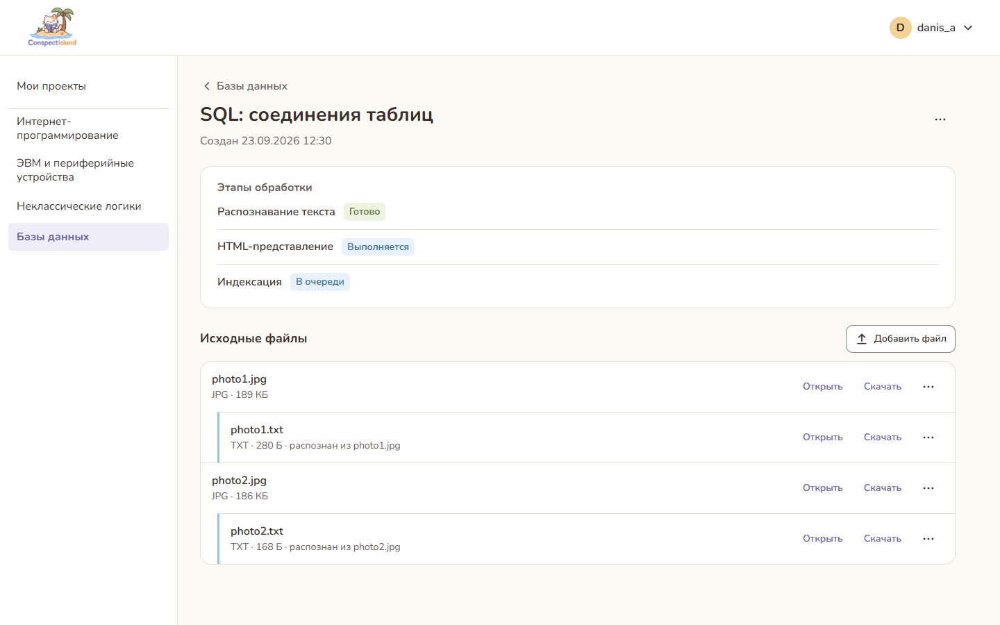
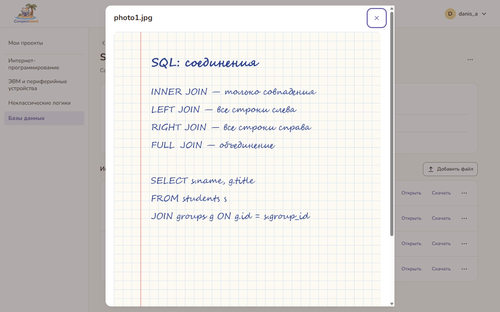
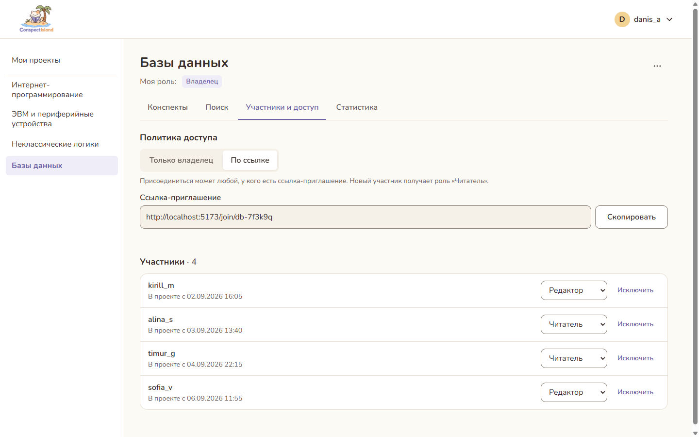
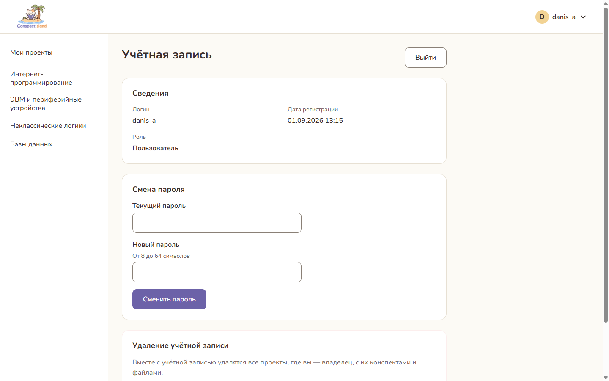

<p align="center">
  
</p>

# ConspectIsland — веб-приложение

Клиентская часть ConspectIsland: личные и совместные базы знаний из учебных конспектов для студентов. Конспекты собираются из файлов TXT, MD и фотографий тетради; система распознаёт текст на фото и собирает единое HTML-представление с формулами в MathML.

Это фронтенд на моковых данных: все обращения к серверу идут через слой `src/api/`, который сейчас отвечает из памяти браузера, а позже будет обращаться к REST API серверной части (C#/.NET).

## Что умеет

- **Вход и регистрация** — проверка логина и пароля по правилам, обязательное согласие, возврат на исходную страницу после входа.
- **Мои проекты** — список проектов с ролью и датой создания, создание проекта.
- **Проект** — конспекты с тремя этапами обработки, сортировка, переименование, удаление, форк, выход из проекта.
- **Конспект** — этапы обработки с запуском и повтором, HTML-представление в изолированном фрейме, исходные файлы: просмотр, скачивание, добавление, замена, удаление.
- **Участники и доступ** — политика «Только владелец» / «По ссылке», ссылка-приглашение, роли «Редактор» и «Читатель», исключение участников.
- **Учётная запись** — сведения, смена пароля, удаление учётной записи.

Интерфейс адаптивный — от 360 до 1920 px: на узком экране меню открывается по кнопке, от 768 px навигация всегда видна в боковой панели. Элементы, недоступные роли, не показываются вовсе.

## Скриншоты



**1. Вход: логотип над формой, переключатель «Вход / Регистрация», поля логина и пароля.**



**2. Регистрация: подсказки к правилам логина и пароля и обязательное согласие с обработкой данных.**



**3. «Мои проекты»: карточки проектов с ролью пользователя и датой создания; слева — навигация по проектам.**



**4. Проект → «Конспекты»: шапка проекта с ролью и меню действий, вкладки, сортировка и статусы трёх этапов обработки у каждого конспекта.**



**5. Конспект → HTML-представление: этапы обработки и собранный документ с формулами в MathML, показанный в изолированном фрейме.**



**6. Конспект → исходные файлы: фотографии тетради и файлы распознанного текста под ними, этапы в работе обновляются сами.**



**7. Просмотр исходного файла: фотография страницы конспекта в окне просмотра.**



**8. Проект → «Участники и доступ» (только владелец): политика доступа, ссылка-приглашение и список участников с ролями.**



**9. «Учётная запись»: логин, дата регистрации и роль, смена пароля и удаление учётной записи.**

## Запуск

Нужен Node.js 22.12+ или 24+.

```sh
npm install
npm run dev
```

Приложение откроется на http://localhost:5173.

### Демо-пользователи

Пароль у всех демо-пользователей — `island2026`.

| Логин | Что посмотреть |
|---|---|
| `danis_a` | Основной пользователь: владелец «Базы данных» и «Интернет-программирование», редактор «Неклассических логик», читатель «ЭВМ и периферийных устройств» |
| `kirill_m` | Владелец «Неклассических логик», редактор «Базы данных» |
| `alina_s` | Владелец «ЭВМ и периферийных устройств», читатель «Базы данных» |
| `admin` | Системная роль «Администратор» |

Моковые данные живут в памяти: изменения сбрасываются при перезагрузке страницы, сессия сохраняется в `localStorage`. Этапы обработки имитируются по времени: «В очереди» → «Выполняется» → «Готово» примерно за 8 секунд.

## Скрипты

| Команда | Что делает |
|---|---|
| `npm run dev` | Сервер разработки Vite |
| `npm run build` | Проверка типов и сборка в `dist/` |
| `npm run lint` | ESLint |
| `npm run test` | Юнит-тесты Vitest: валидация, форматирование, права ролей, логика мок-API |
| `npm run preview` | Просмотр собранной версии |

## Стек

- React 19, TypeScript (strict), Vite
- react-router-dom 7
- CSS Modules; цвета, отступы и размеры — CSS-переменные в `src/styles/tokens.css`, палитра выведена из логотипа
- react-markdown + remark-gfm — просмотр MD без выполнения встроенного HTML
- Шрифт Nunito (`@fontsource/nunito`), подключён локально
- Vitest, ESLint

## Структура

```
src/
  app/          роутер, провайдер авторизации, защита маршрутов, общий layout
  pages/        экраны: каждый собирает себя из компонентов
  components/   общие компоненты без знаний о предметной области
  features/     компоненты областей: auth, projects, conspects, members, account
  api/          функции работы с данными — единственная точка доступа к мокам
  mocks/        моковые данные и имитация обработки конспектов
  types/        типы предметной области
  styles/       токены, reset, глобальные стили
  utils/        форматирование, валидация, права ролей, хуки
```

Правила, которые проверяет ESLint: инлайн-стили запрещены, а импортировать `src/mocks/` можно только из `src/api/`. Права ролей описаны в одном месте — `src/utils/permissions.ts`.

## Что будет позже

Экраны «Новый конспект», «Поиск» с ИИ-диалогом, «Статистика», «Администрирование» и страница присоединения по ссылке-приглашению. Для первых трёх уже есть маршруты-заглушки, а защита маршрутов передаёт `?redirect=`, так что гость, пришедший по ссылке, после входа вернётся к присоединению.
